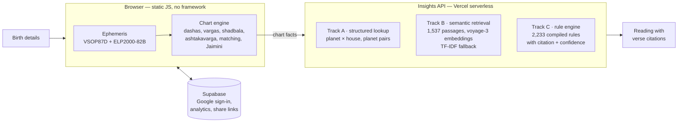

# Astrobserve — product case study

**An AI-native Vedic astrology web app for people who want the reasoning, not just the prediction.** Every reading is traced back to a rule in a classical text: *Phaladeepika*, *Brihat Parashara Hora Shastra* or *Jaimini Sutras*.

**Live (pre-launch):** [astrobserve.vercel.app](https://astrobserve.vercel.app/) · **Status:** pre-launch, no users yet · **Built:** April 2025 – present, solo, with Claude Code

> The source code, knowledge bases and test data are in a private repository: they hold copyrighted book text and real client birth data. This page covers the product thinking and the system design.

---

## 1. The problem

I'm a practising Vedic astrologer on AstroSage. More than 1000 client consultations served as my user research, and they kept surfacing the same gap:

- **Consumer apps** give generic, horoscope-style text. They don't show *which* placement led to *which* conclusion, so a serious user can't judge the reading.
- **Professional software** (Jagannatha Hora and similar) does the calculations, but leaves interpretation entirely to the practitioner. It's dense and desktop-only.
- **LLM chatbots** sound fluent but invent rules. In a domain that is built on specific texts, that kills trust.

**Who it's for:** astrology enthusiasts and early practitioners who want a reading they can check, plus the practitioner (me) who needs a faster first pass before a consultation.

## 2. What it does

| Area | What the user gets |
|---|---|
| Birth chart | Rasi chart and all 16 divisional charts (Shodashvarga), planetary strengths (Shadbala, Bhava Bala), Sudarshan Chakra |
| Timing | Vimshottari dasha timeline, transits, Sade Sati periods and phases |
| Insights | Yogas detected in the chart, with the matching verse and a plain-language reading |
| Matching | Ashtakoota (Guna Milan), Manglik check, reasons shown line by line |
| Remedies | Gemstone guidance tied to the chart |
| Sharing | A transit calendar the user can add to their own calendar |

## 3. Product decisions

**Cite, don't generate.** Readings are retrieved and assembled from classical verses and compiled rules; each one carries its source. The app never shows free-form LLM text as a prediction. This trades some fluency for trust, which is the deciding factor in this category.

**Compute everything in the browser.** The first version called a third-party astrology API for every chart. I replaced it with an in-house ephemeris (truncated VSOP87D for planets, ELP2000-82B for the Moon), so a chart costs nothing to serve and birth details aren't sent to a third party to compute it.

**Treat accuracy as a feature, and measure it.** Astrology users compare results across apps. A one-day difference in a transit date loses them. So every calculation layer is checked against an independent reference (see §5), and decisions such as the choice of ayanamsa are made from data. See the [ayanamsa decision memo](decision-memo-ayanamsa.md).

**Privacy by default.** Birth details are personal data. They are removed from analytics events and error reports, and the privacy page states exactly what a shared link carries.

**Ship in releases with explicit gates.** The work is tracked in a release register with about 30 items across three releases (pre-launch blockers, launch week, post-launch depth). A release checklist lists the verifiers that must pass and the rollback triggers.

## 4. How it works

**Three-track retrieval.** A plain RAG pipeline was the wrong tool for "what does Saturn in the 7th house mean". The answer is a specific verse, not the nearest neighbour. So:

- **Track A, exact lookup.** O(1) retrieval of the verse for an exact placement or conjunction, from *Phaladeepika* chapter 8 (planet × house) and chapter 18 (planet pairs).
- **Track B, semantic retrieval.** For supporting context. 1,537 passages, embedded with voyage-3 (1,024 dimensions) and searched in memory by cosine similarity, with TF-IDF as the fallback. Queries are built from several chart factors at once: planet, house, nakshatra and running dasha.
- **Track C, deterministic rules.** 2,233 rules compiled from a reference text into testable conditions. 1,839 fire against a chart today. The other 394 are *dormant*: each lists the capability it needs (for example divisional charts or transits) and starts firing automatically when that capability ships, with no need to re-extract anything from the book.

## 5. Quality and verification

- **Continuous integration** on every push: secret scanning, a Safari-compatibility check and the calculation verifiers.
- **Golden-file tests** for edge cases that often break astrology software: high northern and southern latitudes, the southern hemisphere, western longitudes, leap days, births at or just before midnight, and very early and very late dates.
- **Ephemeris fidelity:** 2,109 planetary sign changes over ten years all fall within 31 seconds of the Swiss Ephemeris.
- **Agreement with the market reference:** three ayanamsa settings were measured against all 48 planetary sign changes in Drik Panchang's 2026 tables (Drik is the most widely used Indian reference). One variant fit Drik best, with a median gap of 4.1 minutes. The shipped choice stayed with standard Lahiri (median 4.8 minutes) on purpose: it keeps transits and the birth chart on the same zodiac and matches the official standard. The memo records the trade-off and the one near-midnight date it affects. ([memo](decision-memo-ayanamsa.md))

## 6. What's next

Launch through community-led distribution: answering real chart questions in astrology communities, with a measured funnel from reading → visit → sign-up. After that come the parked features from the register, such as further dasha systems and transit search.

---

**Stack:** vanilla JavaScript, Node serverless functions on Vercel, Supabase (Postgres, Google OAuth), Voyage AI embeddings, GitHub Actions. Built with Claude Code.
