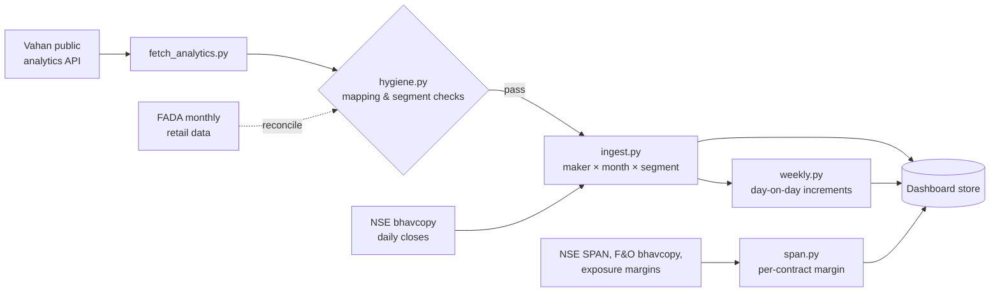

# Vahan auto tracker

**Daily vehicle registrations by manufacturer, mapped to 19 NSE-listed auto stocks. The aim is to read sales weeks before companies report them.**

Auto companies report monthly sales after the month ends. Registrations on the government's Vahan dashboard are posted every day. This pipeline reads them each morning, maps every manufacturer to its listed parent, splits volumes into segments (2W, 3W, PV, CV, tractors), builds weekly series from monthly-only data, and reconciles everything against the dealers' association (FADA) figures before any number reaches the dashboard.

> Part of my private trading toolkit. This public copy contains the pipeline code, its tests and the reference mappings only. No fetched data, personal positions or dashboard are included.

## The PM problems behind the code

| Problem | How the pipeline handles it |
|---|---|
| **Wrong mapping = wrong signal.** Vahan lists makers by legal entity, so an EV subsidiary or demerged company can be counted under the wrong stock (e.g. Chetak → Bajaj Auto, Tata Motors' PV/CV demerger, "Eicher Tractors" belonging to TAFE rather than Eicher Motors). | A reviewed maker → ticker map ([`maker_map.json`](maker_map.json)) with a note for every non-obvious case. Unmapped makers are kept as unmapped and are never assigned by guess. |
| **Segments double-count.** A three-wheeled ambulance appears in two Vahan categories. | [`segments.py`](segments.py) defines each segment as a set operation, and the ingest blocks the run if any segment double-counts. |
| **Monthly data only.** Vahan has no weekly view. | [`weekly.py`](weekly.py) records what Vahan *adds* each day and sums it into Monday–Sunday weeks. Late batch uploads (e.g. from Telangana) are tracked separately as "late", so a backlog never shows up as a sales spike. |
| **Is the source even right?** | [`hygiene.py`](hygiene.py) reconciles against FADA's monthly retail tables. With the current segment rules every mapped ticker agrees within 3% in FADA's latest month. Known structural gaps are documented rather than hidden. |
| **Silent failures.** | Every script either writes data, blocks with a reason, or reports that the source hasn't updated (exit codes 0 / 2 / 3 / 1). Closed months that shrink, a month-to-date that shrinks, or a time-budget overrun all block the run. |

## Pipeline



The pipeline runs as a scheduled routine at 11:00 IST, with a catch-up run at 14:00, because Vahan posts once a day between about 07:30 and 10:00.

`span.py` is a separate utility that estimates the margin each F&O contract blocks. It uses NSE's own end-of-day SPAN scenario files the way the exchange does, because brokers report margin only as an account total.

## Run it

```bash
pip install -r requirements.txt
python3 -m pytest -q tests          # 46 tests
python3 hygiene.py --fada fada.json --series <dir-with-series-docs>
```

**Stack:** Python, requests, BeautifulSoup, openpyxl, pytest. Built with Claude Code.
